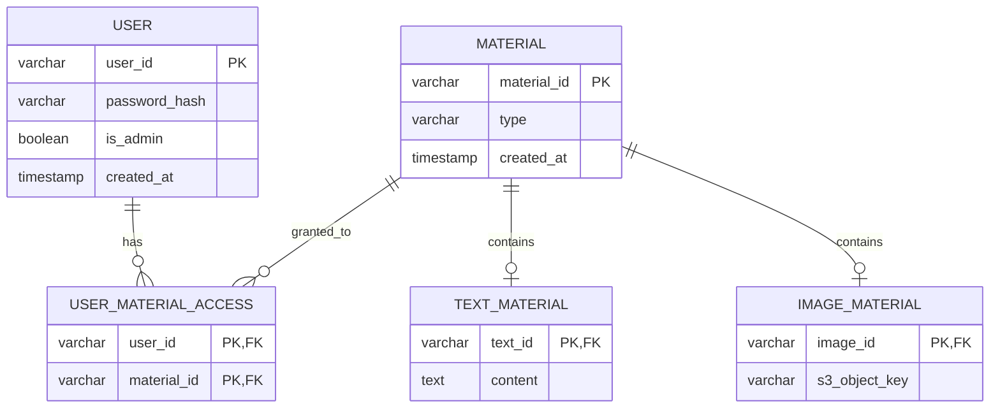

## Database

- `material` stores common metadata for a lesson item.
- `text_material` and `image_material` are one-to-one extensions of the same material row.
- `image_material.s3_object_key` is the private S3 object key used to generate presigned URLs after authorization is checked.
- `user_material_access` is the many-to-many grant table: which user can see which material.
