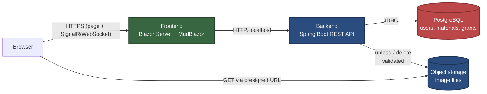
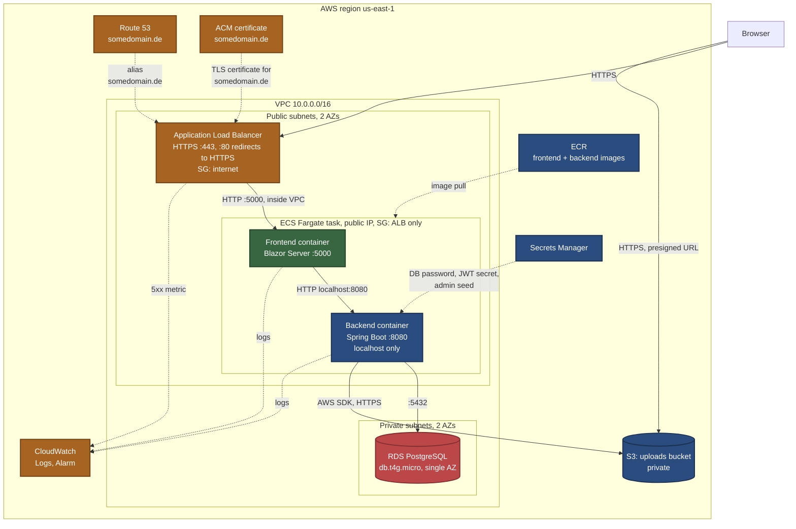

# Mini-Moodle on AWS

## 1. Application and Problem Statement

A small web platform for distributing learning materials (text and images) to selected users.

**Problem:** an instructor wants to share materials with specific people only, without public links and without users having to register themselves on the platform.

**Main Features**

- One admin who is assigned from a secret upon first startup.
- The admin creates user accounts with a username (assigned by admin) and a one-time password.
- On first login the user must set their own password.
- The admin uploads materials (text posts and images) and selects which users may access which material.
- Users see only materials they were granted. Images are served through short-lived presigned S3 URLs, issued only after an authorization check.

## 2. Architecture

### 2.0 Glossary
* **ACM (AWS Certificate Manager)** - handles provisioning, management, and deployment of SSL/TLS certificates.
* **S3 (Simple Storage Service)** - provides scalable object storage for data, backups, and Terraform state files.
* **ECR (Elastic Container Registry)** - stores, manages, and deploys Docker container images.
* **ECS (Elastic Container Service)** - orchestrates and manages Docker containers.
* **ECS Fargate** - runs containers serverlessly without managing underlying EC2 instances.
* **R53 (Amazon Route 53)** - provides scalable DNS routing to translate domain names into IP addresses.
* **ALB (Application Load Balancer)** - distributes incoming HTTP/HTTPS traffic across multiple targets.
* **RDS (Relational Database Service)** - sets up, operates, and scales managed relational databases.
* **OAC (Origin Access Control)** - restricts access to an S3 bucket so only a specific CloudFront distribution can read its files.


### 2.1 Software architecture



| Component | Responsibility |
|---|---|
| Frontend | Blazor Server application: the UI is rendered on the server and kept in sync with the browser over a persistent SignalR (WebSocket) connection. Provides login, admin screens (users, materials, access) and the user material view. It is the only client of the backend, calls it over `localhost` and keeps the JWT on the server side, so the browser only holds a session cookie. |
| Backend | Authentication (BCrypt + JWT), `must_change_password` enforcement, authorization of every material access, upload validation (type, size), presigned URL generation. Not reachable from the internet, only from the frontend container. |
| PostgreSQL | Users, materials (metadata and text), access grants, S3 object keys. |
| Object storage | Image binaries. The bucket is fully private. The browser loads images directly from it via presigned URLs. |

### 2.2 AWS



| AWS service | Used for |
|---|---|
| S3 (1 bucket) | Private storage for uploaded images |
| Route 53 + ACM | Domain `somedomain.de` pointing to the ALB (alias record) and its free TLS certificate (DNS validation) |
| Application Load Balancer | HTTPS termination, HTTP to HTTPS redirect, health checks, WebSocket support for Blazor Server, entry point for the whole application |
| ECS Fargate + ECR | Runs one task with two containers (frontend and backend); ECR stores both images built by the pipeline |
| RDS PostgreSQL | Relational data |
| Secrets Manager | DB password, JWT signing key, initial admin password |
| CloudWatch | Logs of both containers (retention 7 days) |

### 2.3 Network and security groups

| Resource | Subnet | Inbound |
|---|---|---|
| ALB | public | 443 and 80 from the internet (80 only redirects to HTTPS) |
| ECS task | public (public IP) | 5000 from the ALB security group only. Backend port 8080 is not opened, it is reachable only via `localhost` inside the task. |
| RDS | private | 5432 from the ECS security group only |

### 2.4 Key architectural decisions

| Decision | Reason | Trade-off |
|---|---|---|
| Blazor **Server** instead of WebAssembly | Frontend runs as a container next to the backend: no CloudFront, nor frontend S3 bucket. The browser never calls the backend, so no CORS and no JWT in the browser | Persistent SignalR connection per user; sessions are lost on deployment or task restart; scaling to several tasks would require sticky sessions |
| Frontend and backend as two containers in one Fargate task | Backend is reachable only via `localhost`, so it is not exposed to the internet; no service discovery needed | Both are deployed and scaled together (one task definition, one pipeline) |
| ALB with ACM certificate and own domain | HTTPS between browser and ALB; certificate is free and auto-renewed | Own domain and Route 53 zone needed; traffic ALB to task is HTTP inside the VPC |
| Fargate instead of EC2 | No OS or Docker to maintain; rolling updates and health checks via ECS | Higher cost than a single EC2 |
| ECS task in a **public** subnet, reachable only from the ALB security group | Avoids NAT Gateway and interface VPC endpoints | Task has a public IP; protected by the security group only |
| RDS in private subnets | Database has no route from the internet | - |
| Files in S3, metadata and grants in PostgreSQL | DB stays small; authorization stays in one place (backend) | Two stores to keep consistent |
| Presigned URLs for downloads | Backend never touches the actual image bytes on download; bucket stays private | URL stays valid until expiry, even if access is revoked meanwhile |
| Own auth (BCrypt + JWT) instead of Cognito | Easier local development and testing | We maintain security-critical code ourselves |

## 3. Software Delivery Process

```mermaid
flowchart LR
    C[Commit / PR] --> B[Build<br/>Maven + dotnet]
    B --> UT[Unit tests<br/>JUnit, Mockito]
    UT --> IT[Integration tests<br/>Testcontainers + PostgreSQL]
    IT --> SA[Static analysis<br/>SonarCloud, CodeQL]
    SA --> SEC[Security scans<br/>gitleaks, Trivy, Checkov]
    SEC --> TP[terraform validate + plan]
    TP -->|merge to main / tag| IMG[Build and push image to ECR]
    IMG --> TA[terraform apply]
    TA --> DEP[ECS service update<br/>S3 sync + CloudFront invalidation]
```



| Workflow | Trigger | Steps |
|---|---|---|
| `.github/workflows/ci.yml` | PR, push to main | Build, unit tests, integration tests, SonarCloud, CodeQL, gitleaks |
| `.github/workflows/infra.yml` | PR (plan), main/tag (apply) | `terraform fmt -check`, `validate`, Checkov, `plan`, `apply` |
| `.github/workflows/deploy.yml` | main/tag | Docker build, Trivy scan, push to ECR, `aws ecs update-service --force-new-deployment`; frontend: `dotnet publish`, S3 sync, CloudFront invalidation |

## 4. Local Development
(NOT YET IMPLEMENTED)

## 5. Deployment
(NOT YET IMPLEMENTED)

## 6. Repository Layout

```
backend/            Spring Boot application and tests
frontend/           Blazor WebAssembly + MudBlazor
infra/              Terraform (network, rds, alb, ecs, storage, cdn, dns, monitoring)
docker-compose.yml  local PostgreSQL
.github/workflows/  GitHub Actions workflows
```